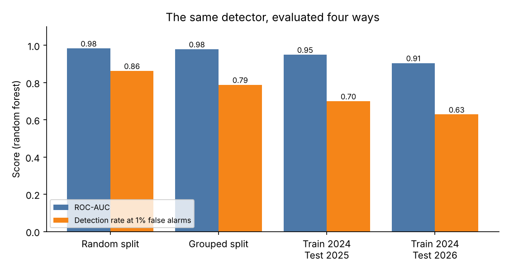
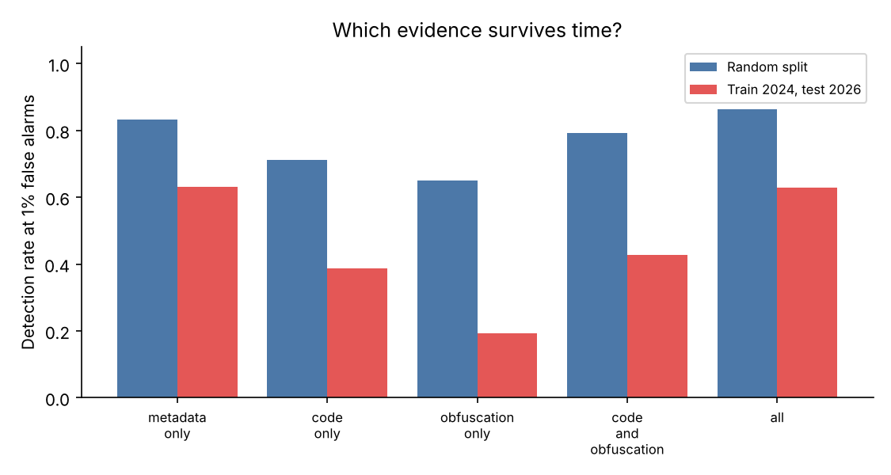
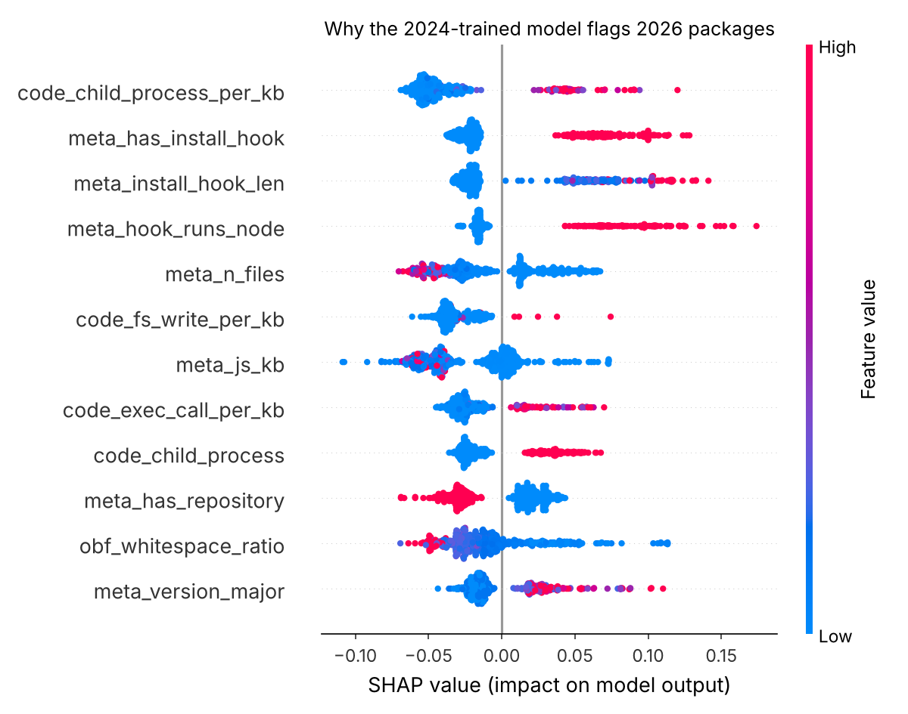

# Does a malicious-package detector survive time?

**Explainable detection of malicious npm packages, and what happens when the evaluation stops being optimistic.**

A static-analysis detector for malicious JavaScript packages scores **0.98 ROC-AUC** under the usual random train/test split. Trained on 2024 malware and tested on 2026 malware, the same detector catches **63%** of malicious packages at a 1% false-alarm rate, down from **86%**. This repository measures where that gap comes from and explains what the model relies on.



## Why this matters

Package registries (npm, PyPI) and extension stores (Chrome Web Store, VS Code Marketplace) face the same problem: attackers publish code that runs with the user's privileges, the store is huge, and the attackers adapt. Machine-learning detectors are often reported with near-perfect lab scores. Rosenzweig, Dalla Valle, Apruzzese and Fass ([*It's not Easy*, ACM TWEB 2025](https://doi.org/10.1145/3770852)) showed for Chrome extensions that such scores do not carry over to real deployment. This project asks the same question for npm, with an open, fully reproducible pipeline:

| | Question | Experiment |
|---|---|---|
| Q1 | How good does the detector look in the lab? | Stratified 5-fold random split |
| Q2 | How much of that is copy-paste campaigns leaking across folds? | 5-fold split grouped by code fingerprint |
| Q3 | Does it survive time? | Train on 2024, test on 2025 and 2026 |
| Q4 | Which evidence survives: metadata, code behaviour or obfuscation? | Feature-group ablation, random vs temporal |
| Q5 | What do the scores mean when malware is rare? | Detection rate at 1% FPR; precision at 1% prevalence |
| Q6 | Why does the model decide what it decides, and what drifted? | SHAP explanations, per-feature drift (KS test), error analysis |

## Data

| | Source | Sample |
|---|---|---|
| Malicious | [DataDog Malicious Software Packages Dataset](https://github.com/DataDog/malicious-software-packages-dataset): real npm malware, each sample manually triaged | 900 per discovery year (2024, 2025, 2026), one version per package name |
| Benign | Names drawn **uniformly at random** from the whole npm registry ([all-the-package-names](https://www.npmjs.com/package/all-the-package-names)), not from popular packages | 900 per publish year, same years |

Random registry packages are deliberately used instead of popular ones: a benign set of well-known libraries makes detection trivially easy (popular packages have READMEs, repositories and many files) and gives a falsely optimistic picture.

`data/features.csv` contains **only derived features** (5,400 packages × 59 features) plus name, version, date and label. **No malware is stored in this repository.**

### Safety

Malicious samples are only *read as text*. Nothing is installed, imported or executed, and extracted samples stay outside the repository.

## Features (all static and interpretable)

| Group | Examples |
|---|---|
| `meta_*` packaging and `package.json` | install hooks (`preinstall`, `postinstall`, …), hook runs `node` / downloads, dependency counts, README / repository / licence present, file counts, version number |
| `code_*` behaviour | `child_process`, `exec`/`spawn`, `eval`/`new Function`, network modules and requests, DNS lookups, IP and URL literals, exfiltration endpoints (Discord / Telegram webhooks, OAST hosts), `process.env`, OS reconnaissance, sensitive paths (`.ssh`, `.npmrc`), file writes, crypto-wallet keywords |
| `obf_*` obfuscation | base64 / `atob` decoding, hex and unicode escapes, `_0x…` identifiers, `fromCharCode`, string entropy, line lengths, whitespace ratio |

Each pattern is recorded both as presence and as density per KB of source.

## Results

Random forest unless stated. Full numbers for all three models (logistic regression, random forest, gradient boosting) are in [`results/results.json`](results/results.json).

| Evaluation | ROC-AUC | F1 | Detection rate at 1% FPR |
|---|---|---|---|
| Q1 Random 5-fold | 0.984 | 0.946 | 0.863 |
| Q2 Grouped 5-fold (no shared code across folds) | 0.980 | 0.936 | 0.788 |
| Q3 Train 2024 → test 2025 | 0.950 | 0.814 | 0.700 |
| Q3 Train 2024 → test 2026 | 0.905 | 0.772 | 0.629 |
| Q3 Train 2024–2025 → test 2026 (retrained) | 0.942 | 0.868 | 0.718 |

### Findings

**1. ROC-AUC hides the problem.** AUC falls only from 0.98 to 0.91, but the detection rate at an operational false-alarm budget (1%) falls from 86% to 63%. A store reviewing thousands of packages a day cares about the second number.

**2. Copy-paste campaigns inflate lab results.** The 2,700 malicious samples collapse to 1,683 distinct code fingerprints; the largest campaign has 103 near-identical packages. Keeping each campaign on one side of the split cuts the detection rate at 1% FPR from 86% to 79% before time is even considered.

**3. Obfuscation and code-pattern features age fastest** (see figure). Obfuscation-only features drop from 65% to 19% detection at 1% FPR; code-only from 71% to 39%. Metadata features survive best (83% → 63%), but they are the easiest for an attacker to change.



**4. The malware changed shape: it now looks like real software.** Among 2026 malware, the packages the 2024 model **missed** differ sharply from those it **caught** ([`results/error_analysis_2026.json`](results/error_analysis_2026.json)):

| 2026 malicious packages | Caught (574) | Missed (326) |
|---|---|---|
| Has an install hook | 91% | 9% |
| Has a README | 26% | 73% |
| Mean number of files | 15 | 49 |
| Mean number of JS files | 8 | 36 |

The 2024 model learned "small package + install hook = malware". By 2026, much malware ships as larger, documented packages that hide the payload in ordinary code paths and need no install hook. Malware descriptions also grew from 8 to 51 characters on average (the strongest drift signal, KS = 0.63).

**5. Rare malware makes false alarms dominate.** At a realistic prevalence of 1% malicious packages, even the best temporal configuration reaches only 0.23–0.44 precision at the default threshold: most alerts would be false. Detection rate at a fixed low FPR is the more honest metric.

**6. What the model looks at.** SHAP on 2026 packages ranks `child_process` usage, install hooks, hooks that run `node`, file counts and file writes highest. These are sensible signals, but each one is easy to avoid, which is consistent with finding 4.



## Implications

- Report detection at a fixed low false-positive rate and on **future** data, grouped by campaign, not only random-split AUC.
- Retraining on recent data helps (63% → 72%) but does not close the gap. Detectors need features that describe *what the code does* (data flows from sensitive sources to network sinks, as in [DoubleX](https://github.com/Aurore54F/DoubleX)) rather than surface patterns.
- The same evaluation protocol transfers directly to browser and IDE extensions, where install-time hooks are replaced by manifest permissions and content scripts.

## Limitations

- **Label noise in the benign class.** Random registry packages are "seemingly benign": some may be undiscovered malware or spam.
- **Selection bias in the malicious class.** DataDog samples were mostly found by one rule set ([GuardDog](https://github.com/DataDog/guarddog)), so the detector partly learns what GuardDog finds.
- **Discovery date ≠ publication date** for malicious samples.
- Regex-based features are approximate; an AST or data-flow analysis would be more precise and harder to evade.
- 900 samples per class per year; results are averaged over one seed.

## Reproduce

```bash
pip install -r requirements.txt

# 1. Malicious samples (partial clone: only the sampled blobs are downloaded)
git clone --filter=blob:none --no-checkout https://github.com/DataDog/malicious-software-packages-dataset.git ../dd
python -I src/fetch_malicious.py --dataset-repo ../dd --out ../work/malicious --per-year 900

# 2. Benign samples from the npm registry
npm pack all-the-package-names && tar xzf all-the-package-names-*.tgz -C ../work
python -I src/fetch_benign.py --names ../work/package/names.json \
    --malicious-manifest ../dd/samples/npm/manifest.json --out ../work/benign --per-year 900

# 3. Features, then all experiments and figures
python -I src/build_dataset.py --malicious ../work/malicious --benign ../work/benign --out data/features.csv
python -I src/experiments.py --data data/features.csv
```

To skip steps 1–3, run `experiments.py` directly on the included `data/features.csv` (about 90 seconds on 2 CPUs).

**Scan a package (static, nothing is executed):**

```bash
mkdir pkg && npm pack left-pad && tar xzf left-pad-*.tgz -C pkg
python -I src/scan.py pkg/
# malicious score: 0.02  (ok)
# main reasons (positive = towards malicious): ...
```

## Repository layout

```
src/fetch_malicious.py   sample + extract DataDog npm malware (outside the repo)
src/fetch_benign.py      random benign sample from the npm registry
src/features.py          static, interpretable features
src/build_dataset.py     feature table + code fingerprints for grouping
src/experiments.py       Q1–Q6, results/results.json, figures/
src/scan.py              score and explain a single package
data/features.csv        5,400 packages × 59 features (no source code)
```

## References

- B. Rosenzweig, V. Dalla Valle, G. Apruzzese, A. Fass. *It's not Easy: Applying Supervised Machine Learning to Detect Malicious Extensions in the Chrome Web Store.* ACM TWEB, 2025.
- A. Fass, D. F. Somé, M. Backes, B. Stock. *DoubleX: Statically Detecting Vulnerable Data Flows in Browser Extensions at Scale.* ACM CCS, 2021.
- Datadog Security Labs. *Open-Source Dataset of Malicious Software Packages*, 2023–. Apache-2.0.

## Author

Zubair, University of Malakand, Pakistan · [github.com/Zubair-DLCS](https://github.com/Zubair-DLCS)

Licence: MIT (code). The derived feature table inherits the attribution requirements of the DataDog dataset (Apache-2.0).
